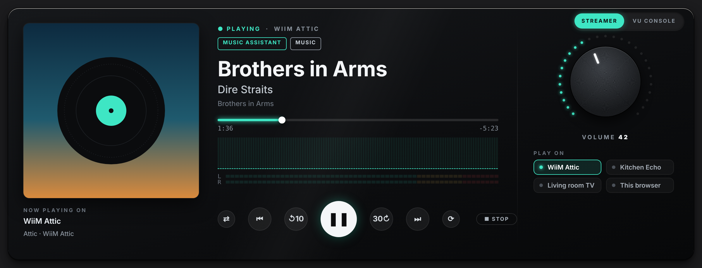
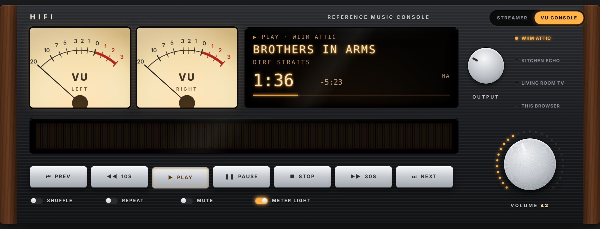

# HiFi Music Player card

A Home Assistant dashboard card that looks and works like premium hi-fi gear. It has two themes: **Streamer** (black glass) and **VU Console** (brushed aluminium with needle meters). It finds your players automatically and has a built-in media browser.




- Works with **every `media_player`** in Home Assistant, including the players Music Assistant creates. The card finds them by itself, or you choose and name them in the editor.
- Shows only the controls each player supports: no dead buttons.
- **Media browser drawer**: local folders, Samba/NFS shares, Music Assistant, Jellyfin, Plex, DLNA servers and radio, in Finder-style columns.
- **This browser** output: plays on the device showing the dashboard, with real level meters and spectrum.
- Lays itself out for any width: wide, compact (tablets) and mini (phones).
- Visual editor, English and Greek, keyboard and screen-reader friendly.

## Install

### HACS (custom repository)

1. HACS → ⋮ → **Custom repositories** → add `https://github.com/gekoul/hifi-music-player-card`, type **Dashboard**.
2. Install **HiFi Music Player** and reload the browser.

### Manual

Copy `dist/hifi-music-player-card.js` to `/config/www/` and add it as a dashboard resource:
`/local/hifi-music-player-card.js` (JavaScript module).

Requires Home Assistant **2026.10** or newer.

## Quick start

```yaml
type: custom:hifi-music-player-card
```

That's all. When Music Assistant is installed, the card lists its players (Music Assistant already wraps AirPlay, Cast, DLNA, Sonos, Squeezebox, Alexa and more, and only exposes real audio outputs). Without Music Assistant it lists media players that look like speakers: they play media and have a volume, and are not TVs, remote-control entities, Jellyfin/Plex sessions, buzzers or voice satellites. Add anything else with `discovery.also`, or in the editor.

A fuller example:

```yaml
type: custom:hifi-music-player-card
theme: console
outputs: auto
discovery:
  exclude: [media_player.bedroom_tv]
  group_by: area
browser_player: true
library:
  folders:
    - path: media-source://media_source/local/Multimedia
      name: Multimedia
volume: { max: 0.7, step: 0.02 }
skip: { back: 10, forward: 30 }
brand: "The Smiths' House"
```

## Options

Everything can be set in the visual editor. YAML reference:

### Players

| Option | Default | What it does |
| --- | --- | --- |
| `entity` | — | One player only, no output selector |
| `outputs` | `auto` | `auto` finds players; or a list of `{entity, name, icon}` / `{browser: true, name}` |
| `discovery.source` | `auto` | `auto`: Music Assistant players when it is installed, otherwise speakers. Or `music_assistant`, `speakers`, `all` |
| `discovery.also` | — | Players to add on top of what is found |
| `discovery.include` / `exclude` | — | Only / never these players (auto mode) |
| `discovery.include_areas` / `exclude_areas` | — | Only / never these areas |
| `discovery.include_integrations` / `exclude_integrations` | — | e.g. `[cast]` |
| `discovery.prefer_music_assistant` | `true` | When a speaker exists natively and in Music Assistant, show it once (the Music Assistant one) |
| `discovery.group_by` | `area` | `area`, `integration` or `none` |
| `discovery.show_unavailable` | `false` | List offline players |
| `browser_player` | `false` | Add the "This browser" output |
| `default_output` | first | Output selected on first load (name or entity) |
| `remember_output` | `true` | Remember the chosen output in this browser |
| `output_helper` | — | Keep the chosen output in an `input_select` (option names = output names) |
| `unavailable` | `dim` | `dim` or `hide` offline outputs |

### Look

| Option | Default | What it does |
| --- | --- | --- |
| `theme` | `streamer` | `streamer` or `console` |
| `theme_switch` | `true` | Show the theme switch on the card |
| `remember_theme` | `true` | Remember the theme per browser |
| `mode` | `dark` | Streamer colours: `dark`, `light`, `auto` (follows Home Assistant) |
| `accent` | teal / amber | Accent colour, e.g. `"#7dd3fc"` |
| `spectrum_colors` | from accent | List of colours, bottom to top |
| `brand`, `model` | empty | Text printed on the Console face |
| `background` | `theme` | `theme`, `card` (your HA theme's card colour) or `transparent` |
| `fonts` | `web` | `system` avoids loading Google Fonts |
| `placeholder_art` | built-in | Image shown when there is no artwork |

### Layout

| Option | Default | What it does |
| --- | --- | --- |
| `layout` | `auto` | `auto` (by card width), `wide` (≥ 900 px), `compact`, `mini` |
| `max_height` | — | Switch to compact if wide would be taller than this |
| `show.*` | all `true` | `art`, `spectrum`, `meters`, `seek`, `outputs`, `switches`, `chips`, `volume` |
| `idle_text` | "Nothing playing" | |

### Controls and behaviour

| Option | Default | What it does |
| --- | --- | --- |
| `skip.back`, `skip.forward` | `10`, `30` | Seconds for the skip keys |
| `volume.step` | `0.02` | Knob step (wheel, keys) |
| `volume.max` | `1` | Top of the knob, e.g. `0.7` |
| `volume.confirm_timeout` | `20` | Seconds the knob stays grey waiting for the player to confirm |
| `visualizer` | `auto` | `auto`: real levels when available (This browser), otherwise still. `animated`: animate while playing. `off` |
| `reduced_motion` | `auto` | Follows the system setting; `true` freezes meters |
| `pause_offscreen` | `true` | Stop drawing when the card is off screen |
| `language` | HA language | `en` or `el` |
| `key` | from the players | Name for what this card remembers per browser (output, theme, drawer). Set different keys when two cards with the same players should remember separately |

### Media browser

| Option | Default | What it does |
| --- | --- | --- |
| `library` | `true` | `false` hides the drawer |
| `library.sources` | all found | `folders`, `music_assistant`, `jellyfin`, `dlna`, `radio`, any integration name (`plex`, `sonos`, `kodi`…) or a media-source id |
| `library.folders` | — | Pinned folders: `{path, name}` |
| `library.start` | Multimedia/Music if found | Folder the drawer opens in |
| `library.open` | `collapsed` | `expanded` to open on load (then remembered per browser) |
| `library.height` | `420` | Drawer height in px |
| `library.view` | `columns` | `columns` or `list` (phones always use list) |
| `library.audio_only` | `true` | Hide video and image files |
| `library.cache_hours` | `12` | How long folder listings are cached in the browser |

## How the media browser finds your music

The drawer looks at what your Home Assistant already has and lists only music. Nothing is configured per integration:

1. **Home Assistant media sources**: local folders and network shares, Radio Browser, DLNA servers, Jellyfin, JellyHA and any other integration that adds one. Cameras, text-to-speech, images and video libraries are left out, as are movie, TV and Live TV branches inside a source.
2. **Libraries reached through an integration's players**: Plex, Emby, Kodi, Squeezebox, Spotify, Sonos, Roon, OwnTone, MPD, Volumio and others. One player of each integration is asked for its library. Integrations whose players only list apps (TVs, PCs) are skipped.
3. **Music Assistant**: favourites, artists, albums, playlists and radio.
4. **JellyHA**: your Jellyfin music as its real folder tree, plus playlists.
5. **On this player**: the selected output's own content, such as WiiM or Sonos presets, favourites and queue. It changes with the output.

Use `library.sources` to limit the list, by the keys above (`folders`, `music_assistant`, `jellyfin`, `radio`, `dlna`) or by any integration name (`plex`, `sonos`, `kodi`, …).

## Network shares (Samba / NFS)

The card never connects to a share itself. Add the share once in Home Assistant:
**Settings → System → Storage → Add network storage**, usage **Media**. It then appears under *Folders* in the drawer, and every player can stream from it through Home Assistant.

## The "This browser" output

- Plays through the dashboard tab and shows real levels on the meters and spectrum.
- Browsers need one tap before audio starts (autoplay rule).
- Streams from other servers without CORS headers still play, but without levels.
- Playback stops when the tab closes or the device sleeps.
- Music Assistant library items and libraries reached through other players (Plex, Sonos…) can't play here. Folders, Jellyfin/JellyHA and other media-source items can.

## Player compatibility

| Integration | Status |
| --- | --- |
| Music Assistant (AirPlay, Cast, Squeezebox, DLNA, Snapcast…) | Tested |
| WiiM / LinkPlay | Tested |
| Sonos, Google Cast, DLNA, HEOS, MusicCast, Bluesound, Spotify, Apple TV, Kodi, Plex, Jellyfin | Not yet tested — reports welcome |

Use the **Player compatibility** issue form to add yours.

## Development

```bash
npm ci
npm run build      # dist/hifi-music-player-card.js
npm run watch
npm test           # unit tests (Vitest) and browser tests (Playwright, test/harness.html with a mock Home Assistant)
```

Releases: bump `version` in `package.json` and merge to `main`. The Release workflow tests, tags `vX.Y.Z` and publishes a GitHub release with the built file, which HACS installs. A version with a hyphen (`1.0.0-beta.1`) becomes a pre-release.

## Licence

MIT
